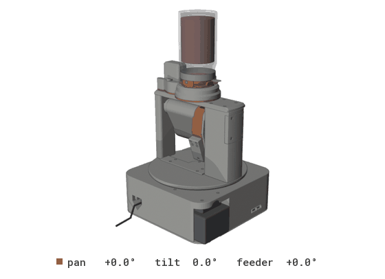
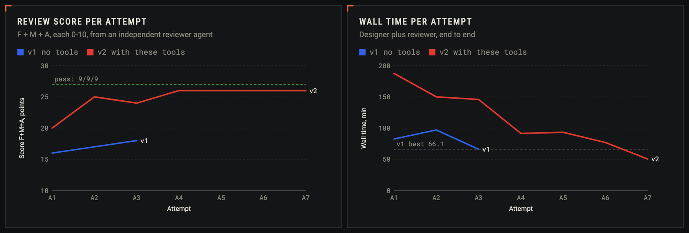
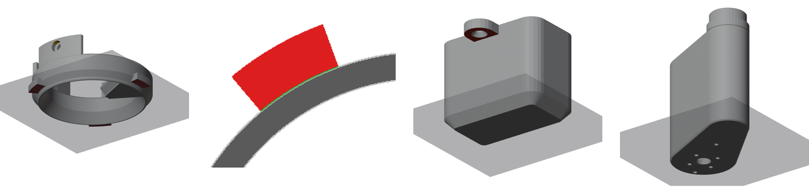
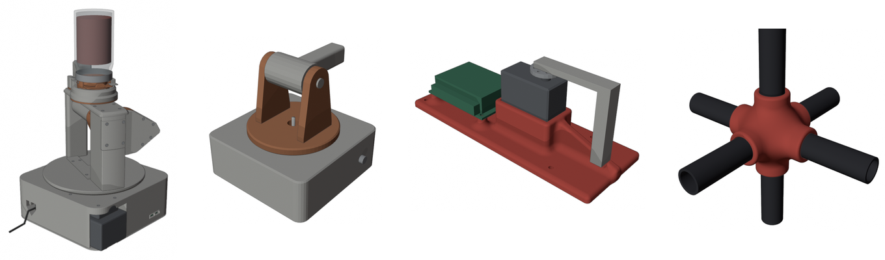

# alex-3d-skills

**Claude designs 3D-printable assemblies in headless Blender. These tools check the design the way a mechanical
reviewer would, before anything gets printed.**

<p align="center"></p>

<p align="center"><sub>The M&M launcher (v2, 36 printed parts), designed by agents, swept through the full pan, tilt and feeder
ranges that <code>cadcheck</code> checks for collisions.</sub></p>

## Why

Agents write CAD code quickly, and they make the same mistakes every time: a screw head under a moving arm, a part
with no way into the assembly, a tab that needs support when the model says it doesn't. Renders don't show any of these.
`cadcheck` finds them by measuring the assembly. It sweeps every joint through its range, drives every screw, tries
every part's way in, and slices every print layer.

Same brief (an M&M launcher on a pan/tilt base), scored by an independent reviewer agent:

| | Best attempt without tools (v1) | With these tools (v2, attempt 7) |
|---|---|---|
| Review score, function / manufacture / looks | 6 / 6 / 6 | **9 / 8 / 9** |
| Wall time, design + review | 66.1 min | **50.5 min** |
| Output tokens | 352k | **173k** |



Every rule in the skills points at the finding that motivated it, in [`docs/FINDINGS.md`](docs/FINDINGS.md).

## What it catches

| Check | Catches |
|---|---|
| `interference`, `clearance` | Collisions and tight gaps across every joint's full range, proven between the sampled poses, not only at them |
| `fasteners` | Reversed screws, heads buried in parts, bolts short of their nut, too little thread, screws no driver can reach |
| `insertion`, `slide` | Parts with no straight way in at their assembly step, or no way out for service |
| `parts` + `cad printcheck` | Unsupported cantilevers, islands and long bridges, layer by layer on the exported STLs |
| `drop`, `payload` | Whether a payload (an M&M, a ball) falls where it should at every pose |
| `cables` | Too-short leads, kinks under the bend radius, ends that pull apart across a joint |
| `calcs`, `snaps`, `flexures` | Computed stress against PLA/PETG allowables for printed sections, snap fits and print-in-place hinges |



<sub>The v2 design shipped `supports: no` on parts that needed support. `cad printcheck` finds them: jar_valve's tabs (the
part drooped when printed), its layer map at z 2 mm, one of feeder_cover's two ears. The nacelle on the right really is fine.</sub>

## Install

You need Blender 5.1+, python3 and [Claude Code](https://claude.com/claude-code). No pip packages. Only tested on macOS.

```sh
git clone https://github.com/alexchunlin/alex-3d-skills.git && cd alex-3d-skills
mkdir -p ~/.claude/skills
ln -s "$PWD/skills/print-cad-blender" ~/.claude/skills/print-cad-blender   # the designer skill
ln -s "$PWD/skills/cad-design-review" ~/.claude/skills/cad-design-review   # the reviewer skill
export BLENDER=/path/to/Blender.app/Contents/MacOS/Blender   # only if Blender isn't in /Applications; put it in ~/.zshrc
```

## Try it (under a minute)

Build the demo turret and check it, then build it again with four classic mistakes planted (a tilt range that hits
the base, a screw head in the barrel's path, a bolt short of its nut, a reversed screw):

```sh
S=skills/print-cad-blender/scripts
$S/cad build examples/demo-turret/build.py --out /tmp/turret
$S/cad check /tmp/turret/demo.blend examples/demo-turret/checks.json /tmp/turret/report.json
#   CADCHECK PASS: 0 fail, 8 warn

$S/cad build examples/demo-turret/build.py --out /tmp/turret-bug --bug
$S/cad check /tmp/turret-bug/demo.blend examples/demo-turret/checks.json /tmp/turret-bug/report.json
#   CADCHECK FAIL: 9 fail, 12 warn
#   FAIL interference: PRT_pan x PRT_barrel collide on different bodies: 136.8 mm3 at tilt=-50
#   FAIL interference: PRT_barrel x FST_proud collide on different bodies: 38.5 mm3 at tilt=-45
#   FAIL fasteners: FST_side stops 0.40 mm short of its nut FST_side_nut: no thread engagement
#   FAIL fasteners: FST_arm_0 head is inside ['PRT_arm_L'] (reversed, or a missing counterbore)
```

Add `--render` to the build for iso, exploded, posed and section views in `/tmp/turret/renders/`.

## Use it on your own design

1. **Start from the template.** `mkdir -p my-robot && cp -r skills/print-cad-blender/templates/project my-robot/blender`. It has
   `params.py` (every dimension), one module per subsystem in `parts/`, `build_assembly.py` and a starter `checks.json`.
2. **Ask Claude to design.** For example: *"Use the print-cad-blender skill. Design a wall mount for this servo in
   my-robot/blender. Run `cad check` and `cad printcheck` before you hand off."* The skill teaches it the conventions,
   `cadlib` and the checks.
3. **Ask for an independent review.** In a fresh session: *"Use cad-design-review to review my-robot. Score it and list
   the issues with evidence."* The reviewer re-runs the checks rather than trusting the designer's report.
4. **Or run the whole loop.** [`templates/cad-loop.workflow.js`](templates/cad-loop.workflow.js) plans, builds each
   subsystem in parallel, finishes, reviews and repeats until the score target. Set `CONFIG.hw` (the folder with `DESIGN_BRIEF.md`
   and `blender/`), `CONFIG.skills` (your clone) and `CONFIG.subsystems` (your `parts/` module names). Builders run on Sonnet by default; planning and review on the session model.



<sub>Built by agents with `cadlib`: the M&M launcher, the demo turret, a servo bracket with grown connectors,
a 6-way tube node.</sub>

## Guidelines

- **Name by role.** `PRT_` printed, `BUY_` purchased, `FST_` fasteners, `CAB_` cables; moving parts hang under
  `PIV_<joint>`. cadcheck reads the prefixes, so a misnamed part goes unchecked.
- **Write intent into `checks.json`, not prose.** Fits, assembly order, drop tests, distances and calcs are re-checked
  on every run; a number in a comment isn't. Every block is documented in
  [`reference/checks-config.md`](skills/print-cad-blender/reference/checks-config.md); the template's starter file and
  [`examples/demo-turret/checks.json`](examples/demo-turret/checks.json) are short examples.
- **Warnings are a to-do list.** Fix each one or accept it with a reason (`accepted_warns`). An accept that no longer
  matches anything is reported as stale.
- **Let the tools place things.** `features.fastener_joint` sizes and cuts a screw joint, `cadlib.route` routes
  cables, `blend.grow` grows connectors. Agents skip these unless the project structure makes them use them.
- **printcheck decides supports.** `cad slice` runs a real slicer, sandboxed, if one works headless. Bambu Studio
  crashes headless; PrusaSlicer is the one to install.

Contributing: see [CONTRIBUTING.md](CONTRIBUTING.md).

## What's in the repo

| Path | What |
|---|---|
| [`skills/print-cad-blender/`](skills/print-cad-blender/) | Designer skill: `cadlib` (geometry, print features, assembly, export, renders), `cadcheck`, `cadq` measurements, the `cad` wrapper, references, project template |
| [`skills/cad-design-review/`](skills/cad-design-review/) | Reviewer skill: check-first protocol, scoring anchors, evidence checklist |
| [`templates/cad-loop.workflow.js`](templates/cad-loop.workflow.js) | Design/review loop for Claude Code's Workflow tool. Resumable, model per role |
| [`examples/`](examples/) | Demo turret, slide gate, connectors, cable router, and every archived M&M launcher attempt the reviewers saw |
| [`tools/verify_all.sh`](tools/verify_all.sh) | Re-proves every claim against the archived designs. `--changed` runs only what a change affects |
| [`tools/bench/`](tools/bench/), [`tools/transcript/`](tools/transcript/) | Replay bench (recall and false fails on 10 archived designs) and agent time and token telemetry |
| [`docs/`](docs/) | [`FINDINGS.md`](docs/FINDINGS.md) (the evidence), [`STATUS.md`](docs/STATUS.md), and a [project dashboard](docs/dashboard/dashboard.html) (download and open it in a browser) |

<details>
<summary><b>Command reference</b></summary>

```sh
S=skills/print-cad-blender/scripts
$S/cad build my/blender/build_assembly.py -- --render
$S/cad check my/blender/model.blend my/blender/checks.json /tmp/cc.json
$S/cad check my/blender/model.blend my/blender/checks.json /tmp/cc.json --only fasteners,service   # 2-13 s subsets while iterating
$S/cad check my/blender/model.blend my/blender/checks.json /tmp/cc.json --overlay my_rows.json        # extra rows without editing checks.json
$S/cad q my/blender/model.blend sweep PRT_launcher PRT_hopper tilt 40 50 2.5   # distance while a joint moves
$S/cad q my/blender/model.blend section x 21 /tmp/cut.png 900,25,185 120       # section render
$S/cad q                                         # every cad q command
$S/cad rows /tmp/cc.json "hood.*flywheel"           # one line per report row (no Blender)
$S/cad bom my/BOM_AND_ASSEMBLY.md my/blender/manifest.json   # BOM fastener table vs the model
$S/cad printcheck my/stl --manifest my/blender/manifest.json --render /tmp/pc   # layer support check on the STLs
$S/cad slice --detect                            # which slicers are usable (runs nothing)
$S/cad sheet my/stl /tmp/sheet.png               # contact sheet of the parts
sh tools/verify_all.sh --changed origin/next --dry-run   # what your change affects
```

`verify_all.sh` without `--changed` takes about 30 minutes or more. A few of its sections read the original M&M launcher
project and agent transcripts on the author's machine. Elsewhere those sections skip or fail with missing files, and
everything else runs from the repo. `cad check` exits 0 even on `CADCHECK FAIL`; read its summary line or the report.

</details>

## Status

v0.1. It is in active use on two projects. Known gaps are listed in [`docs/STATUS.md`](docs/STATUS.md). The main ones:
insertion paths are straight lines only, `cad slice` has not met a real slicer yet, and creep and fatigue are out of
scope.

MIT licensed. See [LICENSE](LICENSE).
